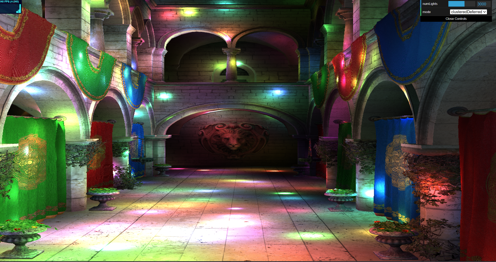
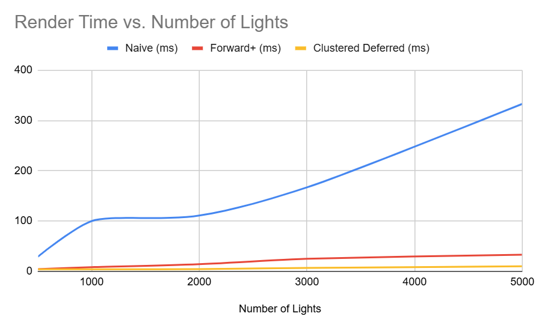

# WebGPU Forward+ and Clustered Deferred Shading

**University of Pennsylvania, CIS 565: GPU Programming and Architecture, Project 4**

* **Name:** Yingxuan Hu
* **LinkedIn:** [linkedin.com/in/yingxuan-hu-bbb9b3380](https://www.linkedin.com/in/yingxuan-hu-bbb9b3380/)
* **Tested on:** Windows 11, Intel(R) Core(TM) i9-14900HX @ 2.20 GHz, NVIDIA GeForce RTX 5070 Ti Laptop GPU (12 GB)
* **Computer:** Personal Computer
* **Browser:** Google Chrome 155.0.8059.80 (Official Build) (64-bit)

## Live Demo

[Live Demo]()

## Demo Video

[Watch the 30+ second demo video on Google Drive](https://drive.google.com/file/d/13wgIYbdRcLjX262hgEXtQhP59WYUxr8h/view?usp=sharing)

---

## Overview

This project implements three real-time rendering approaches in WebGPU: Naive Forward Shading, Forward+ Shading, and Clustered Deferred Shading. Forward+ and Clustered Deferred share the same GPU light-clustering pass, which divides the camera frustum into a 3D grid and stores the point lights that affect each cluster.

## Naive Forward Shading

The Naive Forward renderer serves as the baseline implementation. Each visible fragment loops over every active point light and evaluates its contribution directly. This approach is straightforward, but its cost grows quickly as the number of lights increases because every fragment performs lighting calculations for all lights.

## Forward+ Shading

Forward+ divides the camera frustum into a `16 x 9 x 24` grid of clusters. A compute shader constructs a view-space AABB for each cluster and tests the point lights against these bounds. Each cluster stores the indices of the lights that intersect it. During the forward rendering pass, each fragment determines which cluster it belongs to and only evaluates the lights stored for that cluster instead of looping over the entire light set.

## Clustered Deferred Shading

Clustered Deferred reuses the same light-clustering pass as Forward+. The first rendering pass stores world-space position, normal, and albedo into a G-buffer. A second fullscreen pass reads these G-buffer textures, determines the cluster associated with each visible pixel, and evaluates only the lights assigned to that cluster before writing the final shaded result.

---

## Performance Analysis

### Test Setup

All performance measurements were collected in the Sponza scene using a fixed camera position and a fixed rendering resolution of 1278 x 1345. The same animated point-light configuration was used for Naive Forward, Forward+, and Clustered Deferred, and all tests were run on the same machine and browser. Performance is reported in milliseconds rather than FPS. The timing values were estimated by observing stable FPS values for each renderer and converting them to frame time using `ms = 1000 / FPS`.

### Performance vs. Number of Lights

The graph shows a clear difference in how the three renderers scale as the number of lights increases. Naive Forward performs the worst and scales poorly because every fragment evaluates every active point light. Its frame time increases from 29 ms at 500 lights to 333 ms at 5000 lights. There is a small amount of measurement noise in the middle of the range, but the overall trend is very clear: as the light count grows, Naive Forward becomes dramatically more expensive.

Forward+ scales much better than Naive Forward because each fragment only evaluates the lights stored in its cluster instead of iterating over the full light set. In the measured range, Forward+ increases from 4.3 ms at 500 lights to 33 ms at 5000 lights. This is still an increase, since more lights lead to more cluster-light intersections and larger per-cluster light lists, but the growth is far more manageable than in the naive baseline.

Clustered Deferred scales best in these measurements. Its frame time remains very low across the tested light counts, increasing from 4.1 ms at 500 lights to 10 ms at 5000 lights. Compared with Forward+, it stays flatter as the number of lights rises, and compared with Naive Forward, it is consistently much faster at every measured point. The performance gap also becomes larger at higher light counts. The clustered methods already show a clear advantage at 500 lights, and that advantage becomes overwhelming by 3000 to 5000 lights.

### Forward+ vs. Clustered Deferred

Among the two clustered methods, Clustered Deferred was faster in all of the measured cases. At 500 lights, the two methods were already close, with Forward+ at 4.3 ms and Clustered Deferred at 4.1 ms. As the light count increased, the difference became larger. At 3000 lights, Forward+ took 25 ms while Clustered Deferred took 6.7 ms, and at 5000 lights the gap widened further to 33 ms versus 10 ms. In this project, Clustered Deferred therefore scaled better across the tested range.

Forward+ can still be preferable in some workloads. It shades directly during the geometry pass, so it does not need to write and later read a G-buffer. That means it avoids the extra memory traffic associated with storing position, normal, and albedo. In scenes with relatively low overdraw, moderate geometry complexity, and situations where avoiding G-buffer bandwidth is important, Forward+ can be a good fit.

Clustered Deferred is stronger in workloads where repeated fragment shading would otherwise be expensive. It first stores geometry information in a G-buffer and then performs lighting in a separate fullscreen pass, so only the final visible pixel is lit. This avoids repeating lighting work on fragments that are later hidden by overdraw. That makes it especially attractive for scenes with high overdraw, many overlapping surfaces, and large light counts. Its main tradeoff is the extra G-buffer write and read cost. In scenes with low overdraw or relatively simple lighting, that additional memory bandwidth may provide less benefit.

### Discussion

The main performance result is that Naive Forward is useful as a baseline but scales poorly as the number of lights increases. Forward+ improves scalability by culling lights per cluster so that each fragment considers only a small subset of the total lights. Clustered Deferred reuses the same clustering idea but moves lighting into a separate fullscreen pass. In this project, Clustered Deferred performed best on the Sponza scene, which suggests that avoiding repeated lighting work on geometry-heavy visible surfaces was more important than the additional G-buffer bandwidth cost. A natural next step would be to tune the cluster dimensions or reduce G-buffer cost, for example by reconstructing position instead of storing it directly.

---

## Conclusion

Naive Forward Shading scales poorly with large numbers of point lights because every fragment must evaluate every light. Forward+ substantially improves performance by using cluster-based light culling, and Clustered Deferred further combines that clustering approach with a separate fullscreen lighting pass. In the tested Sponza workload, Clustered Deferred produced the best performance overall, while both clustered methods greatly outperformed the naive baseline as the light count increased.

---

## Credits

- [Vite](https://vitejs.dev/)
- [loaders.gl](https://loaders.gl/)
- [dat.GUI](https://github.com/dataarts/dat.gui)
- [stats.js](https://github.com/mrdoob/stats.js)
- [wgpu-matrix](https://github.com/greggman/wgpu-matrix)